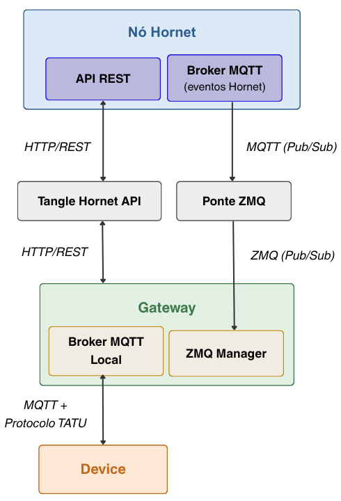
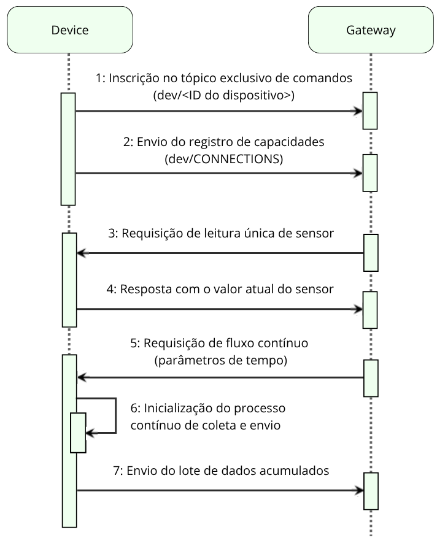
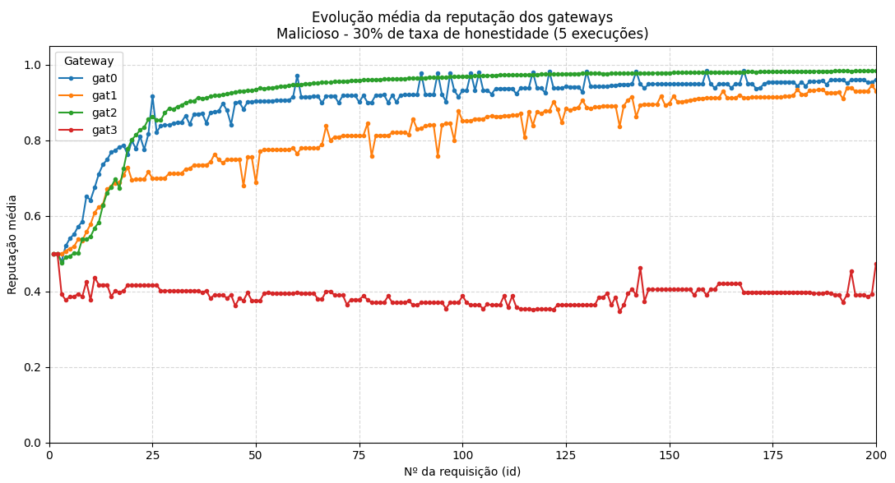
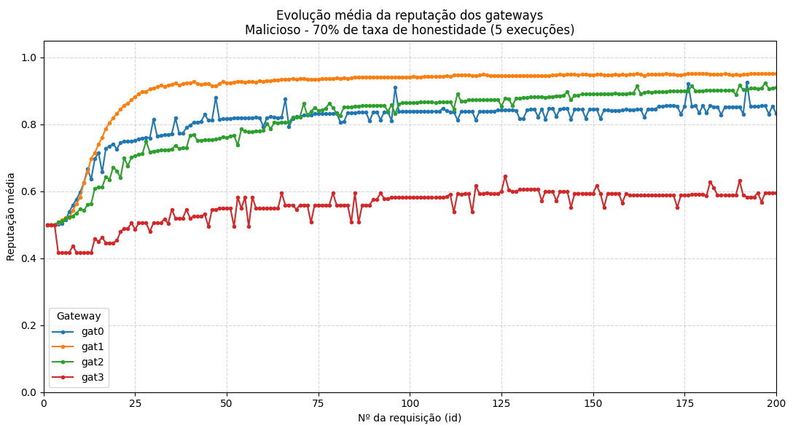
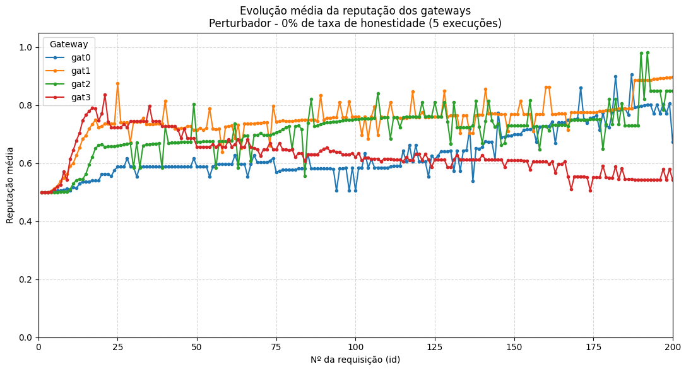
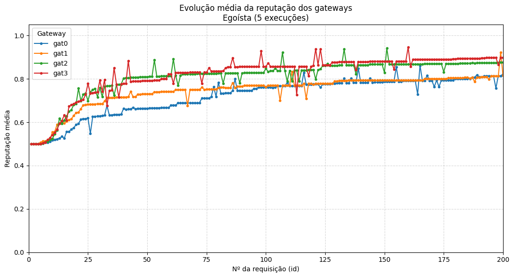

# Soft-IoT Gateway: Sistema de Reputação Distribuída (Zato)

Gateway IoT baseado no **Zato ESB**, integrado ao ecossistema **Soft-IoT** e a um ledger distribuído (**IOTA / Tangle, via nó Hornet**). Cada instância de gateway:

- coleta dados de dispositivos por MQTT (protocolo **TATU**) e os expõe por APIs REST;
- publica e consulta **mensagens** indexadas na Tangle;
- executa um protocolo de **descoberta de serviços**, **seleção por reputação** e **avaliação entre pares**;
- pode simular nós honestos, maliciosos, egoístas e perturbadores.

---

## Sumário

1. [Glossário](#glossário)
2. [Visão geral](#visão-geral)
3. [Versão da DLT](#versão-da-dlt)
4. [Arquitetura](#arquitetura)
5. [Dispositivos IoT e protocolo TATU](#dispositivos-iot-e-protocolo-tatu)
6. [Canais de comunicação com a DLT](#canais-de-comunicação-com-a-dlt)
7. [Formato das mensagens na DLT](#formato-das-mensagens-na-dlt)
8. [Tipos de nó (condutas)](#tipos-de-nó-condutas)
9. [Módulos de serviço](#módulos-de-serviço-implsrcservices)
10. [Fluxo de descoberta de serviços e reputação](#fluxo-de-descoberta-de-serviços-e-reputação)
11. [Cálculo de reputação](#cálculo-de-reputação)
12. [Agendamento e APIs REST](#agendamento-e-apis-rest)
13. [Execução experimental (Fogbed)](#execução-experimental-fogbed)
14. [Resultados experimentais](#resultados-experimentais)
15. [Variáveis de ambiente](#variáveis-de-ambiente)
16. [Empacotamento (Dockerfile)](#empacotamento-dockerfile)
17. [Como construir e executar](#como-construir-e-executar)
18. [Observações e limitações](#observações-e-limitações)
19. [Trabalhos futuros](#trabalhos-futuros)
20. [Estrutura de diretórios](#estrutura-de-diretórios)
21. [Referência rápida de desenvolvimento](#referência-rápida-de-desenvolvimento)
22. [Referências](#referências)

---

## Glossário

| Termo | Significado neste projeto |
|---|---|
| **Gateway** | Instância deste projeto (container Zato). É o nó de névoa do sistema. Na parte de reputação, também é chamado de "nó" (`node_id`, `select_best_node`). |
| **Nó Hornet** | Software de nó da rede IOTA. Mantém a Tangle e expõe a API REST e a API de eventos MQTT. Não confundir com o "nó" (gateway) da reputação. |
| **Tangle** | Estrutura distribuída (DAG) que armazena as mensagens. |
| **Mensagem (*message*)** | Unidade de dados da Tangle na IOTA 1.5 (Chrysalis). Aqui carrega um payload de **indexação** (`index` + `data`). |
| **Índice (*index*)** | Rótulo da mensagem na Tangle. Permite filtrar e consultar mensagens (ex.: `REP_HAS_SVC`). |
| **Tangle Hornet API** | API REST em Go (container próprio) que encapsula a API REST do nó Hornet. Usada pelo gateway para escrever e ler mensagens. |
| **Ponte ZMQ** | Serviço em Go (container próprio) que lê os eventos MQTT do Hornet, filtra por índice e os publica por ZeroMQ. |
| **ZMQ Manager** | Componente do gateway (singleton em Python) que assina a ponte ZMQ e despacha as mensagens para serviços Zato. |
| **TATU** | Protocolo de aplicação sobre MQTT usado entre dispositivos e gateway (registro, `GET`, `FLOW`). |
| **Worker** | Máquina física de um experimento Fogbed. |
| **Provedor / Solicitante** | Gateway que oferece um serviço / gateway que o requisita. Todo gateway assume os dois papéis ao longo do tempo. |
| **Reputação** | Média das avaliações registradas sobre um nó; representa a opinião global do sistema. |
| **Credibilidade** | Medida da veracidade da opinião de um avaliador, obtida pela **confiabilidade** (comparação com a opinião global) e pela **consistência** (comparação com a opinião anterior do próprio avaliador). |

---

## Visão geral

O sistema modela uma rede de **gateways** que:

1. **Armazenam localmente** as leituras de sensores conectados (TATU/MQTT).
2. **Anunciam e descobrem serviços** (tipos de sensor) por meio de mensagens indexadas na Tangle.
3. **Recebem as propostas** de outros gateways em tempo real, pela ponte ZMQ.
4. **Calculam a reputação** dos candidatos a partir do histórico de avaliações gravado na Tangle, filtrando os avaliadores por **credibilidade** (K-Means e métricas de confiabilidade e consistência).
5. **Consomem os dados** do gateway escolhido por HTTP direto (REST Zato, porta `11223`) e **publicam avaliações** na Tangle.

A orquestração periódica (inicialização, agregação, limpeza e ciclo de reputação) é feita pelo **Enmasse**, por meio de `config/enmasse/enmasse.yaml`, que registra os serviços REST e um **external_scheduler** que dispara URLs locais na porta `11223`.

O cálculo de reputação e credibilidade segue as definições de Santos [[12]](#referências), com adaptações (prior de reputação com peso configurável e ajuste dos parâmetros ao ambiente emulado).

---

## Versão da DLT

| Item | Valor |
|---|---|
| Rede | IOTA 1.5 (**Chrysalis**), rede **privada** montada pelo script do Fogbed |
| Nó | **Hornet 1.2.x** |
| Biblioteca da ponte ZMQ | `iota.go/v2` (confirmada no README da ponte) |
| Biblioteca da Tangle Hornet API | versão no `go.mod` (provavelmente `iota.go/v2`) |
| Unidade de dados | *Message*, com payload de indexação (`index` + `data`) |
| Portas do Hornet | REST: `14265`; MQTT (eventos): `1883` |

A terminologia deste projeto (`message`, `messageId`, `/message`) segue a Chrysalis. Em versões posteriores (Stardust) esses termos mudam para *block* e *tagged data*.

---

## Arquitetura

### Organização mínima

O diagrama abaixo mostra a instância mínima da infraestrutura, abstraindo a escalabilidade: um nó Hornet, a Tangle Hornet API, a ponte ZMQ, um gateway e um dispositivo.

<p align="center">
  
  <br><em>Figura 1. Organização mínima da arquitetura do sistema, abstraindo a escalabilidade.</em>
</p>

### Visão por camadas (texto)

```text
Dispositivos ──MQTT/TATU──► Gateway Zato ──HTTP/REST──► Tangle Hornet API ──REST──► Nó Hornet ◄──P2P──► Outros nós Hornet
                                 ▲                                                      │
                                 └──────ZMQ (SUB "REP_")──── Ponte ZMQ ◄──MQTT──────────┘
```

O gateway **não** fala diretamente com o nó Hornet. Toda a integração com a DLT passa por dois containers intermediários, cada um com um papel.

### Componentes do gateway

- **Armazenamento local:** broker MQTT interno e SQLite (leituras dos dispositivos).
- **Mapeamento e API REST:** `devices.json`, comandos TATU e endpoints de dados.
- **Cliente DLT:** serviços Zato que chamam a Tangle Hornet API por HTTP.
- **ZMQ Manager:** assinante ZMQ do prefixo `REP_`.
- **Tarefas de reputação e tipos de nó:** descoberta, seleção, avaliação e credibilidade.
- **Gerenciadores de estado:** identidade (`IDManager`), estado e reputação local (`GatewayStateManager`) e conduta (`NodeTypeManager`).

### Topologia em experimentos distribuídos

- Há **um nó Hornet por worker**; o coordenador e o spammer ficam no worker 0.
- Cada worker executa **uma Tangle Hornet API e uma Ponte ZMQ**, ambas ligadas ao nó Hornet do mesmo worker.
- Os **gateways de um mesmo worker compartilham** essa API e essa ponte.
- Gateways de workers diferentes comunicam-se por dois meios: **indiretamente**, pela Tangle (P2P entre os nós Hornet), na descoberta; e **diretamente**, por HTTP no IP do provedor, no consumo do serviço.

> Os resultados da seção [Resultados experimentais](#resultados-experimentais) foram obtidos em **uma única máquina** (topologia mínima, sem múltiplos workers). A distribuição entre workers é suportada pelo script do Fogbed, mas ainda não foi usada para avaliar escalabilidade.

---

## Dispositivos IoT e protocolo TATU

A camada de percepção é formada por dispositivos virtuais em Python que operam como clientes MQTT e emulam sensores. Cada dispositivo se conecta ao **broker MQTT local do gateway**, o que permite vários dispositivos por gateway.

<p align="center">
  
  <br><em>Figura 2. Diagrama de sequência da comunicação do dispositivo com o gateway.</em>
</p>

1. O dispositivo conecta ao broker e assina seu tópico exclusivo de comandos (`dev/<ID do dispositivo>`).
2. Publica o **registro de capacidades** em `dev/CONNECTIONS`: identificação, coordenadas aleatórias (latitude e longitude) e declaração dos sensores instalados, com os tempos base de coleta e publicação. Isso ocorre **uma única vez, sem reenvio**.
3. Passa a escutar comandos. O protocolo suporta duas operações, com respostas em JSON publicadas em `dev/<ID do dispositivo>/RES`:
   - **`GET`**: leitura instantânea do sensor solicitado;
   - **`FLOW`**: envio contínuo, com intervalo de coleta e intervalo de publicação.

Os valores gerados pelos sensores virtuais são **flutuantes aleatórios** (0 a 100), pois a magnitude dos dados não é relevante para o sistema de reputação. O que importa é que o dado seja enviado em formato válido.

---

## Canais de comunicação com a DLT

O gateway usa dois canais independentes, que só se encontram na Tangle.

| | Canal REST | Canal ZMQ |
|---|---|---|
| Intermediário | Tangle Hornet API | Ponte ZMQ |
| Gateway ↔ intermediário | HTTP/REST | ZeroMQ (PUB/SUB) |
| Intermediário ↔ nó | REST (API do Hornet) | MQTT (API de eventos do Hornet) |
| Papel | Escrever e consultar | Receber notificações em tempo real |
| Iniciativa | Do gateway (requisição/resposta) | Do nó (o gateway só escuta) |
| Sentido | Bidirecional | Somente Tangle → gateway |
| Modelo | *Pull* | *Push* |

### Canal REST: Tangle Hornet API

Serviços Zato do gateway (`requests`, timeout de 10 s) chamam a API definida por `Zato_TANGLE_API_IP` e `Zato_TANGLE_API_PORT` (padrão `127.0.0.1:3000`).

| Serviço Zato | Chamada | Uso |
|---|---|---|
| `soft-iot.dlt.client.api.write` | `POST /message` `{index, data}` | Gravar uma mensagem indexada |
| `soft-iot.dlt.client.api.read_index` | `GET /message/{index}` | Ler as mensagens de um índice |
| `soft-iot.dlt.client.api.read_id` | `GET /message/messageId/{id}` | Ler uma mensagem pelo ID |

A API também oferece `GET /nodeInfo`, `GET /nodeInfo/all` e `GET /message/{index}/{maxMessages}` (até N mensagens da última hora), que o gateway não utiliza nos serviços atuais.

### Canal ZMQ: Ponte ZMQ

A ponte (`iota-zmq-bridge`, em Go) é cliente MQTT do Hornet e servidora ZeroMQ:

1. Assina o fluxo geral de mensagens do nó (via `iota.go/v2`) e descarta as que não têm payload de indexação.
2. Aplica o filtro de índices (`INDEXES`): igualdade exata ou prefixo com curinga no final (`REP_*`).
3. Converte a mensagem para JSON e publica em um socket `PUB` (porta `5556`) no formato `"<índice> <json>"`. O **índice é o tópico ZMQ**.
4. Usa buffer (padrão 1000) e workers (padrão 10) e tenta reconectar ao MQTT a cada 5 s.

O ZMQ Manager do gateway assina o prefixo `REP_` (`Zato_ZMQ_IP`/`Zato_ZMQ_PORT`, padrão `127.0.0.1:5556`), em uma thread daemon com `zmq.green`, e despacha cada mensagem a serviços assíncronos (`invoke_async`).

### O que passa por cada canal

O filtro da ponte nos experimentos é `REP_*`. Por isso:

| Índice | Conteúdo | Canal |
|---|---|---|
| `REP_HAS_SVC` | `REP_SVC_REQ` e `REP_SVC_RES` | **ZMQ** (tempo real) e REST |
| `<gateway_id>` | `REP_EVALUATION` | **Somente REST** (`read_index`) |
| `CRED_<evaluator_id>` | `CRED_UPDATE` | **Somente REST** (`read_index`) |

Escritas sempre usam o REST. O ZMQ não permite escrever nem consultar o histórico.

### Observações

- A **ponte não replica nada**. A propagação entre nós é feita pelo P2P do Hornet. A ponte apenas entrega ao gateway, em tempo real, os eventos do nó ao qual está ligada.
- O ZMQ PUB/SUB **não guarda mensagens**: um gateway desconectado perde o que foi publicado nesse intervalo.
- Um gateway **recebe de volta as próprias mensagens** que escreveu. O tratador de requisições ignora as suas (compara `source` com o próprio id).

---

## Formato das mensagens na DLT

O envelope tem dois níveis. A ponte entrega o JSON da mensagem da Tangle, e o campo `payload.data` é, por sua vez, uma **string JSON** da aplicação, com o campo `type`. O ZMQ Manager faz o parse em duas etapas.

Exemplo do que o gateway recebe pelo ZMQ (tópico `REP_HAS_SVC`):

```json
{
  "id": "558205d4...036c",
  "networkId": 2321005821356827533,
  "nonce": 131365,
  "parentMessageIds": ["9d582069...", "a8055210..."],
  "payload": {
    "index": "REP_HAS_SVC",
    "data": "{\"type\":\"REP_SVC_REQ\",\"idRequest\":\"...\",\"source\":\"<gateway_id>\",\"group\":\"cloud/c1\",\"requestedService\":\"Thermometer\"}"
  }
}
```

### Tipos de mensagem (`type`)

| `type` | Índice | Descrição |
|---|---|---|
| `REP_SVC_REQ` | `REP_HAS_SVC` | Pedido de descoberta: serviço desejado (`requestedService`), `idRequest`, `source`, `group` |
| `REP_SVC_RES` | `REP_HAS_SVC` | Oferta: `target`, `idRequest`, `source`, `ipSource`, `group`, lista `services` (`device_id`, `sensor_id`) |
| `REP_EVALUATION` | `<gateway_id>` do avaliado | Avaliação do provedor: `value`, `serviceEvaluation`, `nodeCredibility`, `source`, `target` |
| `CRED_UPDATE` | `CRED_<evaluator_id>` | Nova credibilidade do avaliador |

---

## Tipos de nó (condutas)

Definidos por `Zato_NODE_TYPE` e `Zato_HONESTY_RATE` (`NodeTypeManager`). A conduta vale para os **dois papéis** do gateway: como **provedor**, determina se os dados oferecidos são válidos; como **solicitante**, determina se a avaliação do provedor é correta.

| Tipo | Valor | Conduta | Comportamento |
|---|---|---|---|
| Honesto | `1` | `HONEST` | Oferece seus sensores reais e avalia o provedor com a nota obtida (fidedigna). |
| Malicioso | `2` | `MALICIOUS` | Como provedor, oferece um dispositivo e um sensor **inexistentes** (`nonexistentDevice`/`nonexistentSensor`); o consumo falha no HTTP direto, o que gera nota baixa. Como solicitante, avalia o provedor com a **nota mínima**. A taxa de honestidade controla com que probabilidade age de forma honesta a cada consulta da conduta. |
| Egoísta | `3` | `SELFISH` | Provê serviços normalmente, mas **não grava avaliações** na Tangle. |
| Perturbador | `4` | `HONEST` e depois `MALICIOUS` | Age como honesto até a reputação local passar de um limiar (0,9). Então ativa a fase de perturbação (`behavior_changed`) e passa a se comportar de modo malicioso, conforme a taxa de honestidade. |

---

## Módulos de serviço (`impl/src/services`)

### Identidade e estado local

| Arquivo | Serviço Zato | Função |
|---|---|---|
| `soft_iot_id_manager.py` | `soft-iot.id.manager` | Singleton: UUID do gateway, IP (`Zato_GATEWAY_REAL_IP`) e grupo (`Zato_GROUP`). |
| `soft_iot_gateway_state.py` | (DAO usado pelas tarefas) | SQLite em `/tmp/gateway_state.db`: reputação local, flag de mudança de comportamento e máquina de estados das requisições (`WAITING_RESPONSES` → ... → `FINISHED`). |

### Armazenamento IoT e API de dados

| Arquivo | Serviços | Função |
|---|---|---|
| `soft_iot_storage.py` | `soft-iot.storage.service` | Inicia o broker MQTT interno, persiste leituras em `/opt/zato/env/soft_iot_data.db` e cadastra dispositivos automaticamente. |
| `soft_iot_aggregation.py` | `soft-iot.aggregation.service` | Agrega leituras brutas em janelas (`Zato_AGGREGATION_WINDOW_MINUTES`). |
| `soft_iot_cleanup.py` | `soft-iot.cleanup.service` | Remove dados antigos (`Zato_DATA_RETENTION_SECONDS`). |
| `soft_iot_api.py` | `soft-iot.api.*` | Endpoints REST: último dado, histórico e agregados. |

### Mapeamento de dispositivos (TATU)

| Arquivo | Serviços | Função |
|---|---|---|
| `soft_iot_mapping.py` | `soft-iot.mapping.*` | Lê `devices.json`, lista dispositivos e envia comandos `GET`/`SET`/`FLOW` por MQTT (TATU). |

### Cliente DLT

| Arquivo | Serviços | Função |
|---|---|---|
| `soft_iot_dlt_client_tangle.py` | `soft-iot.dlt.client.api.write`, `read_index`, `read_id` | HTTP para a Tangle Hornet API: gravar mensagens indexadas e ler histórico. |

### Ponte ZMQ (lado do gateway)

| Arquivo | Serviços | Função |
|---|---|---|
| `soft_iot_zmq_server.py` | `soft-iot.zmq.start`, `soft-iot.zmq.handler.request`, `soft-iot.zmq.handler.response` | `ZMQManager` (SUB, filtro `REP_`) que despacha as mensagens. O tratador de **requisição** procura em `devices.json` os sensores cujo `type` seja igual ao serviço pedido e responde com `REP_SVC_RES` (ou, em conduta maliciosa, com sensores inexistentes). O tratador de **resposta** só aceita se o gateway for o `target` e se a requisição estiver em `WAITING_RESPONSES`. |

A Tangle continua sendo a fonte persistida de verdade. O ZMQ apenas evita *polling* para saber das novas mensagens.

### Comportamento simulado dos nós

| Arquivo | Serviço | Função |
|---|---|---|
| `soft_iot_node_type.py` | `soft-iot.node.evaluation` | `NodeTypeManager`: define a conduta e distorce as avaliações quando malicioso. |

### Reputação e credibilidade

| Arquivo | Serviços | Função |
|---|---|---|
| `soft_iot_kmeans.py` | `soft-iot.kmeans.credibility` | K-Means (k=4) sobre as credibilidades dos avaliadores; seleciona o cluster de maior valor (avaliadores "confiáveis"). |
| `soft_iot_reputation_node.py` | `soft-iot.reputation.orchestrator`, `soft-iot.reputation.credibility.manager` | Orquestrador: lê `REP_EVALUATION`, filtra por K-Means e calcula a média ponderada com prior neutro. Credibility manager: atualiza a credibilidade por *reliability* (vs. consenso) e *consistency* (vs. avaliação anterior). |
| `soft_iot_service_handler.py` | `soft-iot.reputation.task.*`, `soft-iot.gateway.state.get` | Pipeline de tarefas (ver fluxo abaixo). |

---

## Fluxo de descoberta de serviços e reputação

Ciclo disparado pelo scheduler (`check-nodes-services`, a cada 20 s). A propagação entre gateways passa pelo P2P do Hornet. O ZMQ entrega localmente os eventos do nó de cada worker.

### Tarefas (`soft_iot_service_handler.py`)

1. **`check_nodes_services`**: evita concorrência (timeout de 120 s). Cria a requisição local, publica `REP_SVC_REQ` em `REP_HAS_SVC` e dispara `wait_nodes_responses` de forma assíncrona.
2. **`wait_nodes_responses`**: aguarda a janela de coleta. Se a requisição ainda estiver em `WAITING_RESPONSES`, passa para `CHOSING_BETTER_NODE` e chama `select_best_node`.
3. **`select_best_node`**: ranqueia os candidatos pela reputação (`reputation.orchestrator`) e escolhe o maior score.
4. **`request_node_service`**: REST ponto a ponto na porta `11223` do IP do vencedor; gera a nota bruta (sucesso ou falha no consumo); aplica a conduta do nó; atualiza a credibilidade e grava a avaliação na Tangle (exceto o egoísta).
5. **`calculate_reputation`**: recalcula a **própria** reputação do gateway e a persiste em `GatewayStateManager`.
6. **`change_disturbing_behavior`**: para o tipo 4, ativa a fase de perturbação quando a reputação local ultrapassa o limiar. É uma tarefa **recorrente (a cada 20 s)** no scheduler.

---

## Cálculo de reputação

Para um gateway alvo `node_id`:

1. Ler, por `read_index`, as mensagens do índice `node_id` com `type == REP_EVALUATION`.
2. Extrair os pares `(value, nodeCredibility)` de cada avaliação.
3. Executar o K-Means (k=4) nas credibilidades e manter as avaliações cujo avaliador pertence ao cluster de maior credibilidade.
4. Reputação final: média das `value` dos avaliadores confiáveis, combinada com um **prior fixo de 0,5** de peso `Zato_REP_PRIOR_WEIGHT` (padrão 5). O prior evita que as primeiras avaliações causem mudanças bruscas e afastem precocemente as reputações dos nós. O resultado fica no intervalo **[0, 1]**.
5. Sem histórico: reputação neutra de **0,5** (metade do intervalo). Todos os gateways começam assim.

A credibilidade de cada avaliador evolui a cada interação, por meio do `CredibilityManager`, e é persistida em `CRED_<evaluator_id>`:

- **Confiabilidade (*reliability*)**: compara a avaliação do nó com a opinião global (consenso). Limiar: `Zato_RELIABILITY_THRESHOLD`.
- **Consistência (*consistency*)**: compara a avaliação atual com a anterior do mesmo avaliador. Limiar: `Zato_CONSISTENCY_THRESHOLD`.

Nos experimentos, os dois limiares foram fixados em **0,5**.

---

## Agendamento e APIs REST

Configurados em `config/enmasse/enmasse.yaml`.

### Canal REST do gateway

Expõe os serviços sob `/soft-iot/...`, na porta padrão do Zato (**11223**). Agrupa:

- armazenamento local (start, agregação, limpeza, leituras de API);
- mapeamento de dispositivos e coleta TATU;
- cliente DLT e ZMQ;
- K-Means, ID manager e avaliação de nó;
- tarefas de reputação e depuração de estado (`/soft-iot/reputation/task/get-data`).

Entre gateways, o endpoint usado no consumo do serviço é `GET /soft-iot/devices/{device_id}/sensors/{sensor_id}/data/latest`.

### External scheduler

Jobs HTTP para `http://localhost:11223/...` (independentes do scheduler interno do Zato, hoje em grande parte comentado):

| Job | Tipo | Intervalo | Propósito |
|---|---|---|---|
| ID manager | Execução única | +5 s | Inicializa a identidade |
| Local storage start | Execução única | +10 s | Inicia MQTT e SQLite |
| ZMQ start | Execução única | +15 s | Inicia o assinante `REP_*` |
| check-nodes-services | Recorrente | 20 s | Novo ciclo de descoberta |
| calculate-reputation | Recorrente | 20 s | Atualiza a reputação própria |
| change-disturbing-behavior | Recorrente | 20 s | Verifica se o nó perturbador deve mudar de conduta |
| Agregação | Recorrente | 5 min | Dispara a verificação e agregação de dados |
| Limpeza | Recorrente | 20 min | Remove dados expirados (deve ser maior que a janela de agregação) |

Ajuste intervalos e `initial_delay` ao tempo de boot dos containers no Fogbed (os gateways esperam 60 s antes de iniciar o Zato).

---

## Execução experimental (Fogbed)

Script: **`impl/scripts/fogbed_exec.py`**. Monta um `FogbedDistributedExperiment` em que **todos os componentes são containers Docker** na rede emulada `10.0.0.0/8`. O [Fogbed](https://larsid.github.io/fogbed/) permite distribuir os containers em várias máquinas físicas (workers).

1. **`criar_tangle`**: rede IOTA privada (`IotaBasic`), com um nó Hornet por worker. O README original cita coordenador e spammer.
2. **`patch_hornet_templates`**: altera `restAPI.limits.maxResults` (1000 → 50000) e `snapshots.depth` (50 → 500). 
3. **Instâncias virtuais**: uma por worker.
4. **Ponte ZMQ** (`silviozv/iota-zmq-bridge:1.0.0`): `MQTT_IP` do nó Hornet do worker; `INDEXES=REP_*`. Uma por worker.
5. **Tangle Hornet API** (`silviozv/tangle-hornet-api:1.0.1`): porta 3000, ligada ao nó do worker (porta 14265). Uma por worker.
6. **`criar_gateways`**: imagem `silviozv/soft-iot-gateway-zato:1.0.1`, distribuídos entre os workers de forma circular. Cada gateway recebe a API e a ponte do **seu** worker. Executa como `root`, em modo `privileged`, com IP fixo e a porta 11223 exposta.
7. **`criar_devices`**: containers `silviozv/python-iot-device:1.0.0`, conectados ao broker MQTT do seu gateway (`BROKER_IP`, `BROKER_PORT=1883`), com IP fixo. A interface de rede é configurada manualmente no comando de inicialização.
8. **Túneis** entre workers consecutivos, seguidos de `exp.start()` e `iota.start_network()`.

### Sincronização por tempo de espera

A ordem de subida é controlada por esperas fixas, e não por verificação de prontidão:

- gateway: `sleep 60`, para dar tempo à Tangle;
- dispositivo: `sleep 120`, para o Zato e o broker do gateway ficarem prontos. Isso importa porque o dispositivo virtual envia o handshake **uma única vez**, sem reenvio: se o broker não estiver de pé, ele não se registra.

### Parâmetros de simulação

No `__main__`, o exemplo padrão usa 6 gateways honestos, 0 maliciosos, 0 egoístas, 0 perturbadores e 1 dispositivo por gateway. Antes dos gateways, o script gera `config/auto-generated/env.ini` (senhas de API e `Zato_Project_Root`).

**Pré-requisitos:**

- a quantidade de gateways deve ser maior ou igual à de workers;
- os workers precisam ser adicionados a `worker_list`. No script, todas as linhas `exp.add_worker('larsid..')` estão **comentadas**. Com a lista vazia, `criar_tangle` falha.

---

## Resultados experimentais

### Metodologia

- **Topologia mínima, em uma única máquina:** 1 nó Hornet, 1 Tangle Hornet API, 1 ponte ZMQ e **4 gateways**, cada um com 1 dispositivo.
- **Condutas:** 3 gateways (`gat0`, `gat1`, `gat2`) são honestos; o `gat3` assume a conduta avaliada em cada cenário.
- **Repetições:** cada cenário foi executado em **5 rodadas independentes**, cada uma até que cada gateway registrasse ~**200 requisições**. Os gráficos mostram a **reputação média** entre as 5 execuções.
- **Parâmetros:** limiares de confiabilidade e consistência = **0,5**.
- **Máquina de teste:** Acer Nitro AN515-51, Intel Core i5-7300HQ (4 núcleos, 2,50 GHz), 8 GB DDR4, SSD SATA de 1 TB.
- **Serviços dos dispositivos:** todos os gateways possuem todos os serviços possíveis, de modo que a checagem de disponibilidade do serviço é praticamente irrelevante nos testes.

| Cenário | Conduta do `gat3` | Resultado observado |
|---|---|---|
| 1 | Malicioso, 30% de honestidade (agressivo) | Reputação suprimida, estável em torno de 0,4 |
| 2 | Malicioso, 70% de honestidade (furtivo) | Estabiliza em faixa intermediária (~0,6), claramente abaixo dos honestos |
| 3 | Perturbador, 0% de honestidade | Sobe rapidamente até ~0,8 (perto da requisição 20) e declina depois da mudança de conduta |
| 4 | Egoísta | Sem impacto negativo nos demais; todos têm trajetória crescente |

> Os valores aproximados da tabela vêm da leitura dos gráficos.

### Cenário 1: malicioso agressivo (30% de honestidade)

Todos os gateways partem de 0,5. `gat0` e `gat2` convergem rapidamente para valores altos; `gat1` converge mais devagar, mesmo sendo honesto, o que é atribuído à atuação do nó malicioso. A reputação do `gat3` é rapidamente suprimida.

<p align="center">
  
  <br><em>Figura 3. Evolução da reputação média dos gateways no cenário 1 (malicioso, 30% de honestidade).</em>
</p>

### Cenário 2: malicioso furtivo (70% de honestidade)

Com a taxa maior de honestidade, a reputação do nó malicioso converge para uma faixa mais alta que no cenário 1. `gat0` e `gat2` passam mais tempo em faixas de reputação menores que as do cenário 1, o que indica que o nó malicioso teve mais impacto negativo sobre a confiança nos nós honestos. Ainda assim, há margem clara de separação entre o `gat3` e os honestos.

<p align="center">
  
  <br><em>Figura 4. Evolução da reputação média dos gateways no cenário 2 (malicioso, 70% de honestidade).</em>
</p>

### Cenário 3: perturbador (0% de honestidade)

O `gat3` acumula reputação rapidamente atuando como honesto. Ao atingir um valor alto (perto da requisição 20), muda de conduta e passa a agir de forma maliciosa em todas as interações; a partir daí sua reputação declina até o fim do experimento. Os gateways honestos sofrem oscilações, mas terminam com reputação maior que a do perturbador.

<p align="center">
  
  <br><em>Figura 5. Evolução da reputação média dos gateways no cenário 3 (perturbador, 0% de honestidade).</em>
</p>

### Cenário 4: egoísta

Todos os gateways registram trajetória crescente e constante. O nó egoísta não degrada a reputação dos demais: ele apenas deixa de participar das avaliações.

<p align="center">
  
  <br><em>Figura 6. Evolução da reputação média dos gateways no cenário 4 (egoísta).</em>
</p>

### Síntese

- O modelo isola nós altamente prejudiciais (cenário 1) e mantém separação mesmo diante de nós de comportamento malicioso mínimo (cenário 2).
- O sistema revoga a confiança de um nó antes lido como honesto quando seu comportamento malicioso é detectado (cenário 3).
- A reputação isolada é **insensível à não colaboração**: o egoísta mantém reputação alta enquanto não avalia ninguém (cenário 4). Detectar esse tipo de omissão exige outro mecanismo.

---

## Variáveis de ambiente

### Gateway

| Variável | Uso | Valor no exemplo do Fogbed |
|---|---|---|
| `Zato_NODE_TYPE` | 1 honesto, 2 malicioso, 3 egoísta, 4 perturbador | por gateway |
| `Zato_HONESTY_RATE` | Probabilidade de conduta honesta (malicioso e perturbador na fase 2) | 100 (honesto e egoísta); configurável nos demais |
| `Zato_GATEWAY_REAL_IP` | IP anunciado nas respostas de serviço (`ipSource`) | IP fixo do gateway |
| `Zato_GROUP` | Grupo lógico na DLT | `cloud/c1` |
| `Zato_TANGLE_API_IP` / `Zato_TANGLE_API_PORT` | Cliente DLT (padrão `127.0.0.1:3000`) | API do worker / `3000` |
| `Zato_ZMQ_IP` / `Zato_ZMQ_PORT` | Assinante ZMQ (padrão `127.0.0.1:5556`) | ponte do worker / `5556` |
| `Zato_COLLECTION_TIME` / `Zato_PUBLISH_TIME` | Intervalos de coleta e publicação, em segundos, do ciclo MQTT do armazenamento local | `2` / `6` |
| `Zato_AGGREGATION_WINDOW_MINUTES` | Janela de agregação | `10` |
| `Zato_DATA_RETENTION_SECONDS` | Retenção antes da limpeza | `1200` |
| `Zato_REP_PRIOR_WEIGHT` | Peso do prior 0,5 no cálculo de reputação | padrão 5 |
| `Zato_RELIABILITY_THRESHOLD` | Limiar de comparação da confiabilidade | 0,5 nos experimentos |
| `Zato_CONSISTENCY_THRESHOLD` | Limiar de comparação da consistência | 0,5 nos experimentos |
| `Zato_Dashboard_Password`, `ZATO_SSH_PASSWORD`, `Zato_IDE_Password` | Credenciais do Zato | `123456` (apenas experimento) |

### Ponte ZMQ

| Variável | Padrão | Descrição |
|---|---|---|
| `MQTT_IP` / `MQTT_PORT` | `localhost` / `1883` | Broker MQTT de eventos do Hornet |
| `ZMQ_IP` / `ZMQ_PORT` | `0.0.0.0` / `5556` | Endereço onde o servidor ZMQ escuta |
| `INDEXES` | vazio (todos) | Índices a publicar; aceita curinga no final (`REP_*`) |
| `BUFFER_SIZE` / `NUM_WORKERS` | `1000` / `10` | Buffer e número de workers |
| `VERBOSE_MESSAGES` | `false` | Log detalhado das mensagens publicadas |

### Tangle Hornet API (no Fogbed)

| Variável | Valor |
|---|---|
| `API_PORT` | `3000` |
| `TANGLE_NODE_URL` | IP do nó Hornet do worker |
| `TANGLE_NODE_PORT` | `14265` |

### Dispositivo virtual

| Variável | Padrão | Descrição |
|---|---|---|
| `BROKER_IP` / `BROKER_PORT` | `127.0.0.1` / `1883` | Broker MQTT do gateway |
| `DEVICE_NAME` | UUID aleatório | Id do dispositivo (no Fogbed não é definido) |

---

## Empacotamento (Dockerfile)

A imagem estende `rhianpablo11/esb-zato-soft-iot:v12` e faz **hot-deploy** do projeto Zato:

| Destino no container | Origem no repositório |
|---|---|
| `/opt/hot-deploy/myproject/` | Projeto completo (código, serviços, scripts) |
| `/opt/hot-deploy/enmasse/enmasse.yaml` | `config/enmasse/enmasse.yaml` |
| `/opt/hot-deploy/enmasse/env.ini` | `config/auto-generated/env.ini` (gerado pelo script do Fogbed) |
| `/opt/hot-deploy/python-reqs/requirements.txt` | Dependências Python adicionais |
| `/home/ubuntu/mapping_archives/devices_config/` | Arquivos de mapeamento de dispositivos (`impl/src/archives`) |

Os serviços Python ficam em `impl/src/services/` e são carregados pelo runtime do Zato.

---

## Como construir e executar

1. **Construir a imagem do gateway**, na raiz de `myproject`:
   ```bash
   docker build -t silviozv/soft-iot-gateway-zato:1.0.1 .
   ```
   Publique ou atualize a tag usada no Fogbed sempre que os serviços forem alterados.
2. **Imagens necessárias** nos workers: `silviozv/soft-iot-gateway-zato`, `silviozv/iota-zmq-bridge`, `silviozv/tangle-hornet-api`, `silviozv/python-iot-device` e as imagens do Hornet usadas pelo `fogledgerIota`.
3. **Preparar o ambiente:** instalar o Fogbed e o pacote `fogledgerIota`, e descomentar em `fogbed_exec.py` os workers que serão usados.
4. **Executar:**
   ```bash
   python impl/scripts/fogbed_exec.py
   ```
   Para encerrar, digite `p` no terminal.
5. **Acompanhar:** os logs dos serviços Zato usam o logger `zato.zmq` (ZMQ) e os logs padrão do Zato dentro de cada container de gateway.

---

## Observações e limitações

- **Estado volátil:** o estado do gateway fica em `/tmp/gateway_state.db`, que se perde ao reiniciar o container.
- **Credenciais fixas:** as senhas (`123456`, `senha123`) servem apenas para o experimento. Não use em produção.
- **ZMQ sem histórico:** um gateway que estiver fora do ar perde as mensagens `REP_HAS_SVC` publicadas nesse período.
- **Ponte compartilhada:** a ponte e a API são pontos únicos de falha para os gateways do mesmo worker.
- **Concorrência na ponte:** vários workers da ponte chamam `Send` no mesmo socket ZMQ, e sockets ZMQ não são thread-safe. Em carga alta isso é um suspeito em caso de perdas.
- **Sincronização por tempo:** a ordem de subida depende de esperas fixas. Se o ambiente for lento, aumente-as.
- **Valores dos sensores:** os dispositivos virtuais geram valores aleatórios (0 a 100) para qualquer tipo de sensor.
- **Amostra limitada nos testes:** os resultados vêm de 5 execuções por cenário, em uma única máquina e com 4 gateways. A escalabilidade não foi avaliada.
- **Egoísmo não detectado:** a reputação isolada não penaliza nós que não colaboram com avaliações.

---

## Trabalhos futuros

- Realizar mais de 5 execuções por cenário, para obter dados estatisticamente mais confiáveis.
- Explorar a distribuição do Fogbed em várias máquinas (workers), com cenários de alta taxa de requisições e avaliações, para avaliar escalabilidade.
- Testar outros algoritmos de confiança e outros valores dos parâmetros (pesos e limiares), analisando o impacto na identificação de nós maliciosos.
- Incorporar um mecanismo para detectar a não colaboração (nó egoísta).
- Simplificar a arquitetura, incorporando a Tangle Hornet API e a ponte ZMQ ao próprio gateway (API dentro do Zato e comunicação direta com o broker MQTT do Hornet), aproximando o sistema de uma topologia real.

---

## Estrutura de diretórios

```text
myproject/
├── Dockerfile
├── README.md
├── docs/
│   └── images/                 # Figuras usadas neste README
│       ├── arquitetura.png
│       ├── sequencia-dispositivo-gateway.png
│       ├── reputacao-cenario1-malicioso-30.png
│       ├── reputacao-cenario2-malicioso-70.png
│       ├── reputacao-cenario3-perturbador.png
│       └── reputacao-cenario4-egoista.png
├── config/
│   ├── enmasse/enmasse.yaml    # REST + external_scheduler
│   ├── auto-generated/env.ini  # Gerado pelo script do Fogbed (deploy)
│   └── python-reqs/requirements.txt
└── impl/
    ├── scripts/fogbed_exec.py  # Orquestração Fogbed + Tangle + gateways
    └── src/
        ├── services/           # Serviços Zato (lógica principal)
        └── archives/           # devices.json → mapeamento no container
```

---

## Referência rápida de desenvolvimento

- **Serviços:** implementados em Python, herdando `zato.server.service.Service`; o nome é registrado no atributo `name` e mapeado em `enmasse.yaml`.
- **Invocações internas:** `self.invoke('soft-iot....')` e `self.invoke_async(...)` entre serviços do mesmo cluster Zato.
- **Estado de experimento:** requisições, respostas e reputação local no SQLite do gateway; dados de sensores em `soft_iot_data.db`; histórico global de reputação na Tangle.
- **Build:** reconstruir a imagem a partir do `Dockerfile` e atualizar a tag usada no Fogbed quando houver alterações nos serviços.

Detalhes de configuração do cluster Zato/Enmasse seguem a documentação da imagem base `esb-zato-soft-iot`.

---

## Referências

- IOTA Foundation. *IOTA Documentation*. <https://docs.iota.org/>
- IOTA Foundation. *iota.go*. <https://github.com/iotaledger/iota.go>
- LARSID. *Fogbed*. <https://larsid.github.io/fogbed/>
- A. C. S. Santos. *Sistema de Reputação Distribuído com Blockchain para Ecossistemas IoT*. Trabalho de Conclusão de Curso, Universidade Estadual de Feira de Santana.
- A. K. Jain. "Data clustering: 50 years beyond K-means". *Pattern Recognition Letters*, vol. 31, no. 8, pp. 651–666, 2010.
- Zato Source. *zato*. <https://github.com/zatosource/zato>
